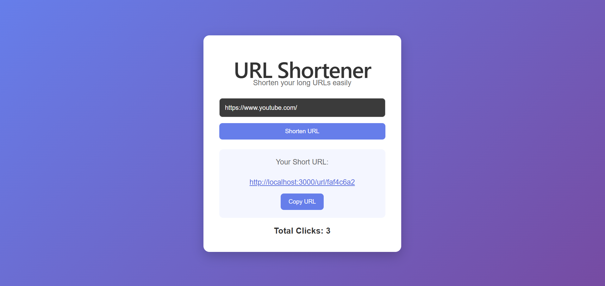
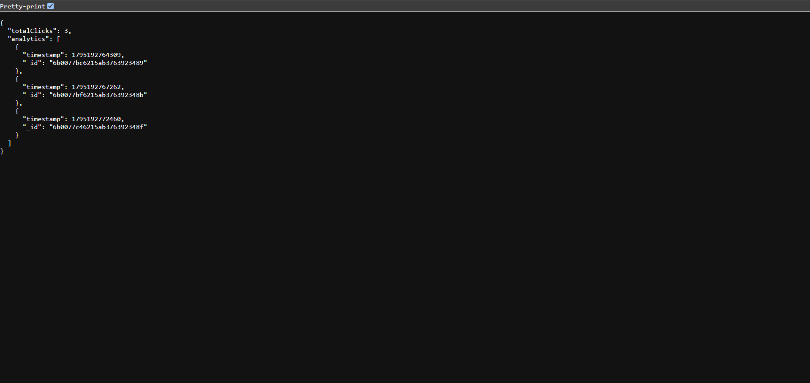

# MERN Stack URL Shortener

A full-stack URL Shortener application built using the MERN Stack. It allows users to convert long URLs into short links and track link click analytics.

## Features

- Convert long URLs into short URLs.
- Redirect users to the original URL using the short link.
- Track total clicks on each shortened URL.
- View URL analytics.
- Automatically refresh click analytics.
- Copy shortened URLs with one click.
- Validate URLs before submitting.
- Responsive user interface.

## Tech Stack

**Frontend**
- React.js
- Vite
- CSS

**Backend**
- Node.js
- Express.js
- MongoDB
- Mongoose

## Project Structure

```text
URL-MAIN_PROJECT/
├── BACKEND/
├── FRONTEND/
├── .gitignore
└── README.md
```

## Author

**Devendra Solanki**

[GitHub Profile](https://github.com/Devendra00077)


## Installation & Setup

### 1. Clone the Repository

```bash
git clone https://github.com/Devendra00077/URL-MAIN_PROJECT.git
cd URL-MAIN_PROJECT
```

### 2. Backend Setup

```bash
cd BACKEND
npm install
```

Create a `.env` file inside the BACKEND folder:

```env
PORT=3000
MONGO_URL=your_mongodb_connection_string
```

Start the backend server:

```bash
npm start
```

### 3. Frontend Setup

Open a new terminal:

```bash
cd FRONTEND
npm install
npm run dev
```

Open the frontend URL shown in your terminal (usually `http://localhost:5173`).


## API Endpoints

| Method | Endpoint | Description |
|---|---|---|
| POST | `/url` | Create a short URL |
| GET | `/url/:shortId` | Redirect to the original URL |
| GET | `/url/analytics/:shortId` | Get URL click analytics |

### Example

**Create Short URL**

POST `http://localhost:3000/url`

**Redirect**

GET `http://localhost:3000/url/:shortId`

**Get Analytics**

GET `http://localhost:3000/url/analytics/:shortId`


## Screenshots

### Home Page



### URL Analytics

